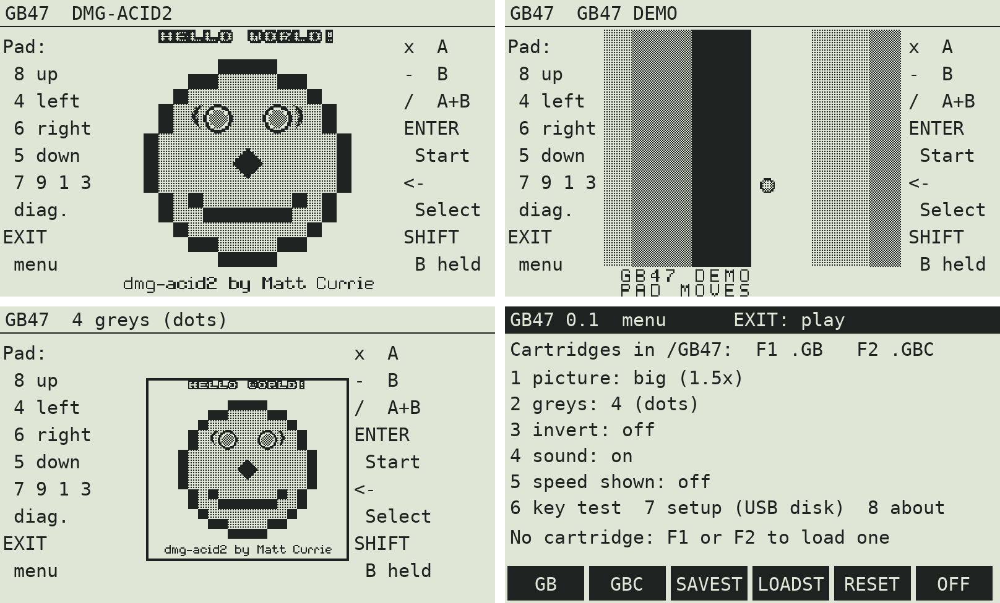

# GB47 — a Game Boy for the DM42n

**GB47** is a Game Boy emulator as a native DMCP5 program (`.pg5`) for the SwissMicros **DM42n**, built like
[ZX47](https://github.com/valdesvj/zx47.pg5) (the loop, the screen, the menu), [HP47](https://github.com/valdesvj/hp47.pg5)
(the ROM read from the disk as needed) and [Chess 47](https://github.com/valdesvj/chess47.pg5). The Game Boy itself is
[Peanut-GB](https://github.com/deltabeard/Peanut-GB) (MIT), which passes Blargg's CPU tests and dmg-acid2.



- **Original Game Boy cartridges** (DMG): ROM only, MBC1, MBC2, MBC3 (with its clock) and MBC5, up to 8 MB.
  Dual-mode cartridges (a black `.gbc`, such as Pokémon Gold or Zelda DX) run as on a Game Boy; Game Boy Color-only
  cartridges do not.
- **Four greys** on the black-and-white LCD as dot patterns (white, 1 dot in 4, every other dot, black), or two-tone.
- **Big** (1.5×, 240×216) or **small** (1×, 160×144, fewer lines to send: faster when everything scrolls).
- **Music** on the buzzer: the tune's melody (see *Sound* below).
- **The game's saves** (the cartridge's battery RAM) in `/GB47/<game>.SAV`, written by themselves; **save states**.
- **Big cartridges** (Pokémon 1 MB, Zelda 512 KB) read from the disk 4 KB at a time into a cache, as HP47 reads the
  HP 48's ROM, when the heap can't hold the whole ROM.

**Status: 0.1, the first version. Tested in the PC simulator and with the PC tests, not yet on a DM42n.**
How fast it runs on the calculator is the next thing to measure (see *Speed*).

## Installing and playing

1. Copy `release/GB47.pg5` to the calculator's disk (keep `DM42-x.yy.pg5` there too, to go back).
2. Make a folder **`/GB47`** on the disk and copy your cartridges into it as `.gb` (or `.gbc`) files. To try GB47
   without a game, copy `release/GB47DEMO.GB`: our own little cartridge (bands of the four greys scrolling, a ball the
   pad moves, a tune).
3. **SETUP → System → Run DMCP** (or RESET with F1 held), **Load program → GB47.pg5**.
4. The menu opens: **F1** lists the `.gb` files, **F2** the `.gbc` files. Pick one, and it plays. Next time GB47
   starts with the same game, its saves read back.

Needs DMCP5 3.57 or later. GB47 comes with no games: use your own cartridges' dumps or homebrew.

### Keys

| Key | Game Boy | | Key | GB47 |
|---|---|---|---|---|
| **8** / ▲ | up | | **EXIT** | the menu |
| **4** | left | | **SHIFT** | B held down (on/off), for games that run with B |
| **6** | right | | **F1** (held) | fast forward |
| **5** / **2** / ▼ | down | | **F2** | sound on/off |
| **7 9 1 3** | the diagonals | | **F3** | 4 greys / two-tone |
| **×** | A | | **F4** | big / small |
| **−** and **+** | B | | **F5** | screenshot (`/SCREENS`) |
| **÷** | A and B together | | **F6** | speed shown on/off |
| **ENTER** and **R/S** | START | | | |
| **←** and **.** | SELECT | | | |

The calculator reads **two keys at once**. A direction and a button is fine; for three buttons, **÷** presses A and B
together (6 + ÷ is Mario's running jump), and **SHIFT** keeps B down (then 6 + × runs and jumps).

### The menu (EXIT)

| | |
|---|---|
| **F1 GB**, **F2 GBC** | load a cartridge from `/GB47` |
| **F3 SAVEST** | save the whole Game Boy as it is now: `/GB47/<game>.STA` |
| **F4 LOADST** | go back to that state |
| **F5 RESET** | restart the game (its saves stay) |
| **F6 OFF** | turn off; ON comes back to the game where it was |
| **1 – 5** | picture big/small, greys, invert, sound, speed shown |
| **6** key test, **7** DMCP's setup (USB disk, time, System), **8** About | |

**EXIT** or **ENTER** goes back to the game.

### The game's saves

A game "saves" by writing its cartridge RAM. GB47 writes that to `/GB47/<game>.SAV` two seconds after the game last
wrote to it ("game saved" shows in the status line), and when the menu opens or the calculator turns off. The file
is the usual `.sav` of other emulators: you can bring your saves over, or take them to a PC.

## Sound

The Game Boy has four voices; the DM42n's buzzer has one, with no volume. GB47 keeps the Game Boy's sound registers
as the real one does (lengths, volume envelopes, channel 1's sweep) and plays one note: the louder of the two
square-wave channels (the higher one when both are as loud, which is usually the melody), the wave channel (the bass
in most games) only when both are silent, and never the noise channel (the drums). So you hear the tune, not the
chords. **F2** turns it off.

## Speed

The game always runs at the Game Boy's own speed (59.7 frames a second) as long as the calculator keeps up; the LCD
shows as many of those frames as it can. FPS47's numbers (below) say the LCD takes about 0.22 ms a line: a whole big
picture 48 ms, so 15–20 shown frames a second when everything moves (scrolling), and every frame when only a little
of the screen changes (menus, text, Pokémon's battles). GB47 draws a frame only when the LCD will have finished the
last one, so time isn't spent drawing frames nobody sees.

**F6** shows the speed in the status line: `98% z4.1 s9.0 18fps` is the Game Boy's speed, ms to run a frame, ms to
draw one, and frames shown a second. Please send me those numbers from your games, on battery and on USB.
If a game is slow when everything scrolls, try **small** (F4): 144 lines instead of 216.

## Memory and the ROM cache

When the heap has room for the whole cartridge (and 96 KB for the rest), it is read into memory. When it does not
(Pokémon is 1 MB), the ROM file stays open and is read 4 KB at a time as the game needs it, into a cache as big as the
heap allows; bank 0 always stays. *About* (menu 8) shows which, the cache's size and how many pieces were read.
The first time a game reaches a new part (a new town, a new world) it may wait a moment for the disk.

## The tool: FPS47, the LCD frame-rate test


`release/FPS47.pg5` measures the heap a program gets, then runs nine tests of about 3 seconds each, and shows the
results on the screen:

| Test | What it does |
|---|---|
| FULL forced | all 240 lines change every frame, `lcd_forced_refresh` |
| FULL fill | the whole screen black / white with `lcd_fill_rect`, `lcd_refresh` (DMCP's own way) |
| **GB lines** | a Game Boy frame (160×144 drawn 1.5× = 240×216, 4 greys as dot patterns) written straight into the LCD buffer, `lcd_refresh_lines` on its 216 lines — **the emulator's way** |
| GB forced | the same frame, all 240 lines sent |
| GB rects | the same frame drawn with `lcd_fill_rect` (as NAV47 and TERM47 draw) |
| GB draw only | the drawing alone, no refresh: the CPU's part |
| lines only | sending 216 unchanged lines: the LCD's part |
| ZX full | a ZX Spectrum frame (256×192, 1 bit, 1:1) written straight in, all its 192 lines sent |
| **ZX part** | the same frame, only the band of lines that changed sent: a sprite moving in a still room, as Knight Lore or Head over Heels draw — **the Spectrum emulator's way** (for [ZX47](https://github.com/valdesvj/zx47.pg5)) |
| heap (at start) | the largest block `malloc` gives, and the total free (shown on the start page and in the results) |

For each test: **fps** (frames a second), **draw** (ms of drawing a frame) and **lcd** (ms the LCD takes a frame).
Every frame waits for the LCD to finish, so the fps is what you see.

**GB (F1)** and **ZX (F2)** run the Game Boy picture or the Spectrum room without end, with the frame rate on the
left: look whether the moving ball or sprite smears or flickers.

### Results on Victor's DM42n (FPS47 0.1)

| | Battery (80 MHz) | USB (160 MHz) |
|---|---|---|
| GB lines (a big Game Boy frame) | 11.4 fps | 16.9 fps |
| drawing one frame (FPS47's slow way; GB47 draws 8 pixels at a time from tables) | 36 ms | 11 ms |
| sending 216 lines | 51 ms | 48 ms |

### How to run it

1. Copy `release/FPS47.pg5` to the calculator's disk (keep `DM42-x.yy.pg5` there too, to go back).
2. **SETUP → System → Run DMCP** (or RESET with F1 held), **Load program → FPS47.pg5**.
3. **On battery** (USB cable out): press **RUN** (F5). Wait about 27 s.
4. **On USB power** (cable in): press **RUN** again.
5. The results are saved as `/FPS47/RESULT_BAT.TXT` and `/FPS47/RESULT_USB.TXT`. Connect the USB disk and send
   them, or a photo of the screen.

**EXIT** stops a test. **OFF** (F6) turns the calculator off; load your usual program from the DMCP menu.

FPS47 loads on DMCP5 3.57 or later (interface 3.17): no firmware update needed. (Version 0.2 as first published
asked for 3.58 and showed "> 3.18" on older firmware: take this one.)

### What the numbers decide

| GB lines, fps | For a Game Boy emulator |
|---|---|
| 30 or more | smooth: draw every 2nd Game Boy frame (the Game Boy makes 60) |
| 15–30 | playable: draw every 3rd or 4th frame, the game itself still runs at full speed |
| under 15 | slow-moving games only (puzzles, RPGs), or a smaller picture |

| ZX part, fps | For a ZX Spectrum emulator |
|---|---|
| 25 or more | as the real Spectrum: Knight Lore, Head over Heels, Gunfright run at their own speed |
| 12–25 | close to the original: those games draw only 10–15 frames a second themselves |
| under 12 | slower than the original in busy rooms |

The heap decides the machines: a 48K Spectrum needs 64 KB, a 128K Spectrum 128 KB + 32 KB, a Game Boy 16 KB + the
cartridge (32 KB to 1 MB: large cartridges are read from the disk in pieces).

## Build

Requirements: `arm-none-eabi-gcc` with newlib, `make`, `python3` (Pillow for the simulator pictures).

```bash
cd ~/opt/gb47.pg5
make              # -> build/GB47.pg5
make test         # the PC tests: Blargg's cpu_instrs and instr_timing, dmg-acid2, the ROM cache, save states, sound
make shots        # the simulator's screens -> build/sim/run/*.png
make demo         # release/GB47DEMO.GB from tools/mkdemo.py
make fps          # FPS47 -> build/fps/FPS47.pg5
```

The simulator runs the real GB47 against a fake DMCP layer, with the dmg-acid2 test cartridge and the demo
(`SIM_HEAP=120` makes the heap small, to try the ROM cache). Its timings mean nothing: only the calculator gives
the real speed.

## Files

| | |
|---|---|
| `src/main.c` | the loop, the menu, files, saves, power |
| `src/gb.c` | the Game Boy around Peanut-GB: the ROM (in memory or the cache), the cartridge RAM, the picture, save states |
| `src/sound.c` | the sound registers, and the buzzer's note |
| `src/screen.c` | the picture on the LCD: 1.5× or 1×, the greys as dots, only the changed lines sent |
| `src/keys.c` | the keys |
| `third_party/peanut_gb/` | Peanut-GB 1.3.0 (MIT), unchanged |
| `test/gbtest.c`, `test/roms/` | the PC tests and their test cartridges (see its README) |
| `tools/mkdemo.py` | GB47DEMO.GB, our own cartridge, written as Game Boy machine code |
| `tools/fps47/` | FPS47: `fps47.c`, its `main.h` (program name, version) |
| `dmcp/`, `stm32_program.ld` | the SwissMicros DMCP5 SDK (BSD-3) |
| `src/sercon_ifc.h` | DMCP5 3.58's serial console (for later) |
| `tools/pg5tool.py` | makes the `.pg5` (from Chess 47) |
| `test/sim/` | the PC simulator (`gbsim.c` from ZX47; `sim.c` for FPS47) |

## License

GPL-3.0-or-later (see `LICENSE` and `NOTICE`). Peanut-GB is MIT; the DMCP5 SDK files are BSD-3 (`LICENSE.DMCP5_SDK`).

This project was written with the help of AI; see [AI_ASSISTANCE.md](AI_ASSISTANCE.md).

SwissMicros and DM42 are trademarks of their owners. Game Boy is a trademark of Nintendo. This project is not
affiliated with or endorsed by them, and comes with no games: use homebrew games or your own dumps.
